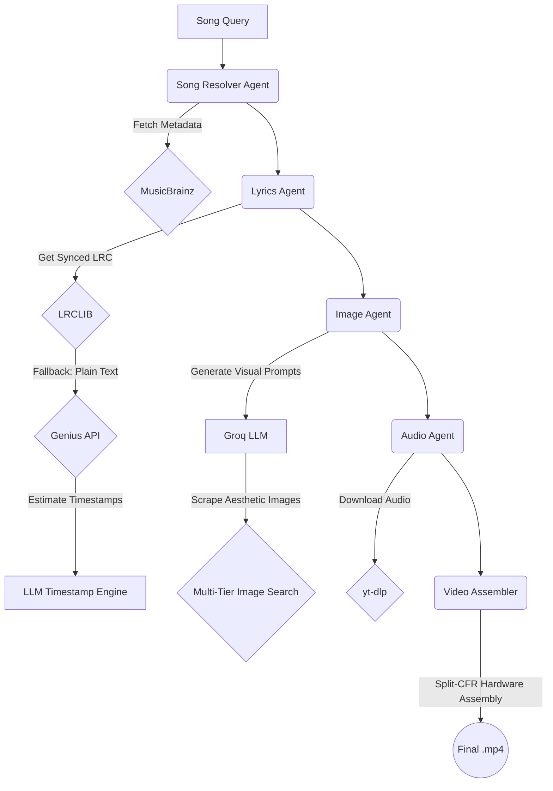

# YLine — Multi-Agent Lyric Video Pipeline

[](https://pjpangilinan.github.io/yline/)
[](https://www.python.org/)
[](https://langchain-ai.github.io/langgraph/)
[](https://github.com/astral-sh/uv)

**YLine** is a fully autonomous LangGraph pipeline that coordinates specialized AI agents to dynamically generate perfectly synchronized, aesthetic lyric videos from a simple song query.

---

## 🌐 Live Showcase

Experience the interactive scrollytelling showcase running on GitHub Pages:

👉 **[https://pjpangilinan.github.io/yline/](https://pjpangilinan.github.io/yline/)**

Explore every stage of the multi-agent pipeline (Metadata Resolution, Lyric Syncing, Mood-Matched Image Scraping, and Video Assembly) across 5 full tracks:
- **Lotus Juice** — *Color Your Night*
- **Panic! at the Disco** — *London Beckoned Songs About Money Written by Machines*
- **AJR** — *100 Bad Days*
- **Owl City** — *This Isn't the End*
- **Porter Robinson** — *Shelter*

---

## 🚀 How It Works

The pipeline is built on a conditional State Graph and uses Groq LLMs to orchestrate APIs, reason through edge cases, and handle fallbacks.



### The Architecture
1. **Song Resolver**: Resolves official track metadata via MusicBrainz with fielded query fallbacks and fast-path heuristics.
2. **Lyrics Agent**: Retrieves synced `.lrc` lyrics from LRCLIB using harmonic token $F_1$ scoring and duration proximity (falling back to Genius + LLM estimation), with vocal pause holding and word-count duration scaling.
3. **Image Agent**: Generates tailored visual palettes via an LLM Art Director, querying multi-tier sources (DuckDuckGo, Bing, Wikimedia) with geometric 16:9 filtering ($w/h \ge 1.15$) and perceptual hash deduplication.
4. **Audio Agent**: Downloads official studio audio via `yt-dlp` using composite ranking (token $F_1$, duration alignment, channel authority) to exclude live, demo, or altered tracks.
5. **Video Assembler**: Composites high-contrast typography and LANCZOS-scaled backgrounds with Pillow, then renders via Split-CFR hardware-accelerated FFmpeg (`h264_nvenc` or `libx264`) at constant 24fps CFR.

---

## 💻 Local Showcase Server

To view the showcase locally:

```bash
# Serve the docs directory
uv run python -m http.server 8080 -d docs
```
Then visit `http://localhost:8080` in your browser.

---

## 🛠 Setup & CLI Usage

Ensure you have [uv](https://github.com/astral-sh/uv) installed, then:

```bash
# 1. Sync dependencies
uv sync

# 2. Configure environment variables
cp .env.example .env

# 3. Run the CLI pipeline
uv run yline "Song Name by Artist"
```

### Running Tests

```bash
uv run python -m unittest discover tests
```

---

## 📄 License

MIT
